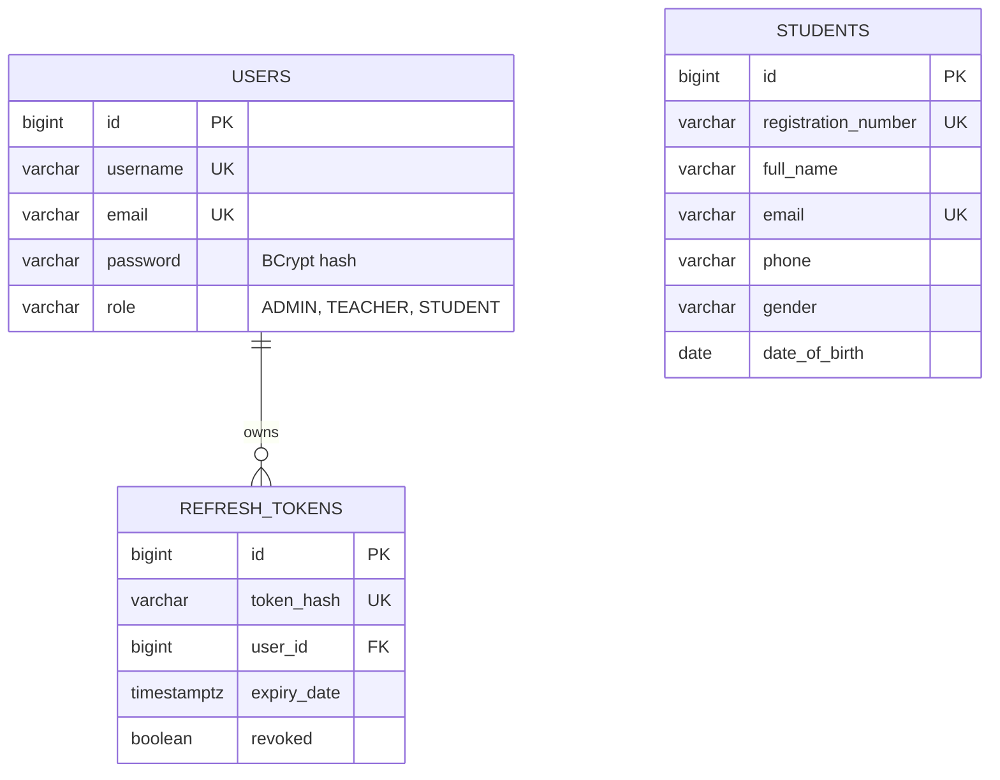

# Student Management System ERD

`users.role` stores one enum role on each account. Refresh tokens belong to a
user and are stored as SHA-256 hashes. A student record is independent of a
login account; connect these concepts with a foreign key only if the product
later requires every student to sign in.
